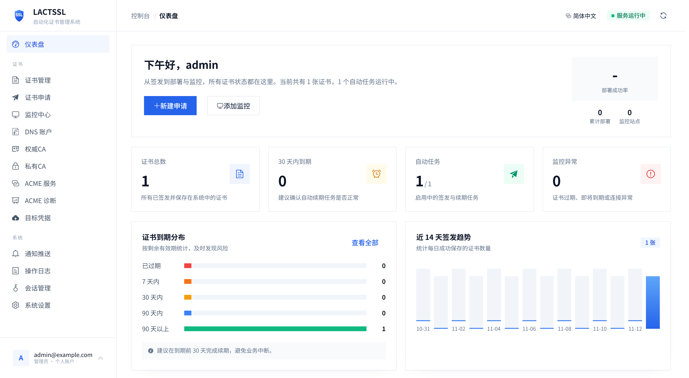

---
hide:
  - navigation
  - toc
---

<section class="hero" markdown>
<div class="hero-badge">Go + Vue 3 · Self-hosted · Self-deployed</div>

# LACTSSL

<p class="hero-sub">A self-hosted SSL certificate manager: ACME issuance and auto-renewal, certificate deployment, endpoint certificate monitoring, and notifications.</p>

[Get started](install.md){ .md-button .md-button--primary }
[GitHub repository](https://github.com/AXmishell/LACTSSL){ .md-button target="_blank" rel="noreferrer" }
[Features](features.md){ .md-button }
</section>

[{ .doc-screenshot .doc-screenshot--home }](assets/images/dashboard.png){ target="_blank" rel="noreferrer" }

<div class="feature-grid" markdown>

<div class="feature-card" markdown>
### :material-certificate-outline: ACME automation
Request single-domain, multi-domain, and wildcard certificates via DNS-01, with automatic renewal, account reuse, and failure retries.
</div>

<div class="feature-card" markdown>
### :material-file-export-outline: Multi-target deployment
Local directories and SSH are built in; FTP, Webhook, Alibaba Cloud CDN, Qiniu Cloud, BaoTa, 1Panel, SafeLine WAF, and more can be added through deployment plugins.
</div>

<div class="feature-card" markdown>
### :material-lock-outline: Private CA
Generate or import root and intermediate certificates to issue certificates, with certificate and private key downloads.
</div>

<div class="feature-card" markdown>
### :material-monitor-eye: Certificate monitoring
Monitor expiry dates and chain details for external endpoints, and trigger notifications automatically on abnormal status.
</div>

<div class="feature-card" markdown>
### :material-bell-ring-outline: 20+ notification channels
Email, Gotify, ServerChan, Telegram, webhooks, and more, covering task and monitoring events.
</div>

<div class="feature-card" markdown>
### :material-shield-check-outline: Security first
Secret entry path, TOTP two-factor authentication, CSRF protection, encrypted sensitive fields, and secondary verification for sensitive operations.
</div>

</div>

## Quick start

=== "Build from source"

    ```bash
    git clone https://github.com/AXmishell/LACTSSL.git
    cd LACTSSL
    cp config.yaml.example config.yaml && chmod 600 config.yaml
    cd web && npm install && cd ..
    make build
    ./bin/lactssl
    ```

=== "Docker"

    Use the complete Compose file from the repository root:

    ```yaml title="docker-compose.yml"
    --8<-- "docker-compose.yml"
    ```

    ```bash
    docker compose pull
    docker compose up -d
    ```

After startup, open the secret entry address printed in the logs and create an administrator account when prompted. See [Installation](install.md) for requirements and the complete steps.

## Technology stack

| Layer | Implementation |
| --- | --- |
| Backend | Go + Gin + SQLite |
| Frontend | Vue 3 + Vite + Element Plus |
| ACME | lego / RFC 8555 |
| Storage | SQLite (sensitive fields encrypted) |
| Deployment | Single binary with embedded frontend assets |

## Documentation

<div class="doc-grid" markdown>

<div class="doc-card" markdown>
[:material-download: Installation](install.md)
<span>Requirements, building from source, Docker deployment, and first access.</span>
</div>

<div class="doc-card" markdown>
[:material-cog-outline: Configuration](configuration.md)
<span>`config.yaml` fields, environment variables, secret entry, and keys.</span>
</div>

<div class="doc-card" markdown>
[:material-format-list-checks: Features](features.md)
<span>Certificate issuance, DNS providers, deployment targets, notifications, and monitoring.</span>
</div>

<div class="doc-card" markdown>
[:material-shield-lock-outline: Security](security.md)
<span>Sessions and CSRF, encryption, TOTP, rate limiting, and reverse proxies.</span>
</div>

<div class="doc-card" markdown>
[:material-wrench-outline: Operations](operations.md)
<span>Backup and restore, versioning, upgrades, and logs.</span>
</div>

<div class="doc-card" markdown>
[:material-code-braces: Development](development.md)
<span>Common commands, directory layout, CI, and i18n checks.</span>
</div>

</div>
