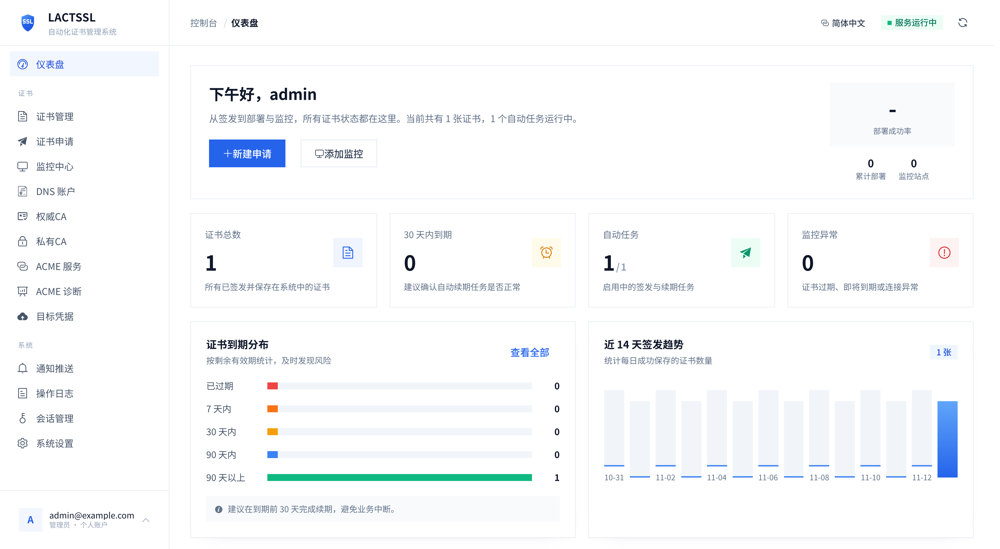

---
hide:
  - navigation
  - toc
---

<section class="hero" markdown>
<div class="hero-badge">Go + Vue 3 · 自托管 · 自部署</div>

# LACTSSL

<p class="hero-sub">自托管的 SSL 证书管理工具：ACME 申请与自动续期、证书部署、站点证书监控和通知。</p>

[快速开始](install.md){ .md-button .md-button--primary }
[GitHub 仓库](https://github.com/AXmishell/LACTSSL){ .md-button target="_blank" rel="noreferrer" }
[功能说明](features.md){ .md-button }
</section>

[{ .doc-screenshot .doc-screenshot--home }](assets/images/dashboard.png){ target="_blank" rel="noreferrer" }

<div class="feature-grid" markdown>

<div class="feature-card" markdown>
### :material-certificate-outline: ACME 自动化
通过 DNS-01 申请单域名、多域名与通配符证书，支持自动续期、账户复用和失败重试。
</div>

<div class="feature-card" markdown>
### :material-file-export-outline: 多目标部署
本地目录、SSH、FTP、Webhook，以及阿里云 CDN、七牛云、宝塔、1Panel、雷池 WAF 等目标。
</div>

<div class="feature-card" markdown>
### :material-lock-outline: 私有 CA
生成或导入根证书与中间证书，作为证书申请的签发机构，并支持证书与私钥下载。
</div>

<div class="feature-card" markdown>
### :material-monitor-eye: 证书监控
监控外部站点证书的到期时间与链信息，异常状态自动触发通知。
</div>

<div class="feature-card" markdown>
### :material-bell-ring-outline: 20+ 通知渠道
邮件、Gotify、ServerChan、Telegram、Webhook 等通知方式，覆盖任务与监控事件。
</div>

<div class="feature-card" markdown>
### :material-shield-check-outline: 安全优先
安全入口、TOTP 两步验证、CSRF 防护、敏感字段加密和敏感操作二次认证。
</div>

</div>

## 快速开始

=== "源码构建"

    ```bash
    git clone https://github.com/AXmishell/LACTSSL.git
    cd LACTSSL
    cp config.yaml.example config.yaml && chmod 600 config.yaml
    cd web && npm install && cd ..
    make build
    ./bin/lactssl
    ```

=== "Docker"

    使用仓库根目录的完整编排文件：

    ```yaml title="docker-compose.yml"
    --8<-- "docker-compose.yml"
    ```

    ```bash
    docker compose up -d --build
    ```

启动后访问日志中打印的安全入口，按提示创建管理员账户。环境要求与完整步骤见[安装与启动](install.md)。

## 技术栈

| 层级 | 实现 |
| --- | --- |
| 后端 | Go + Gin + SQLite |
| 前端 | Vue 3 + Vite + Element Plus |
| ACME | lego / RFC 8555 |
| 存储 | SQLite（敏感字段加密） |
| 部署 | 单二进制，前端资源内嵌 |

## 文档

<div class="doc-grid" markdown>

<div class="doc-card" markdown>
[:material-download: 安装与启动](install.md)
<span>环境要求、源码构建、Docker 部署与首次访问。</span>
</div>

<div class="doc-card" markdown>
[:material-cog-outline: 配置](configuration.md)
<span>`config.yaml` 字段、环境变量、安全入口与密钥。</span>
</div>

<div class="doc-card" markdown>
[:material-format-list-checks: 功能说明](features.md)
<span>证书申请、DNS 服务商、部署目标、通知与监控。</span>
</div>

<div class="doc-card" markdown>
[:material-shield-lock-outline: 安全](security.md)
<span>会话与 CSRF、加密、TOTP、限流与反向代理。</span>
</div>

<div class="doc-card" markdown>
[:material-wrench-outline: 运维](operations.md)
<span>备份与恢复、版本号、升级与日志。</span>
</div>

<div class="doc-card" markdown>
[:material-code-braces: 开发](development.md)
<span>常用命令、目录结构、CI 与国际化检查。</span>
</div>

</div>
