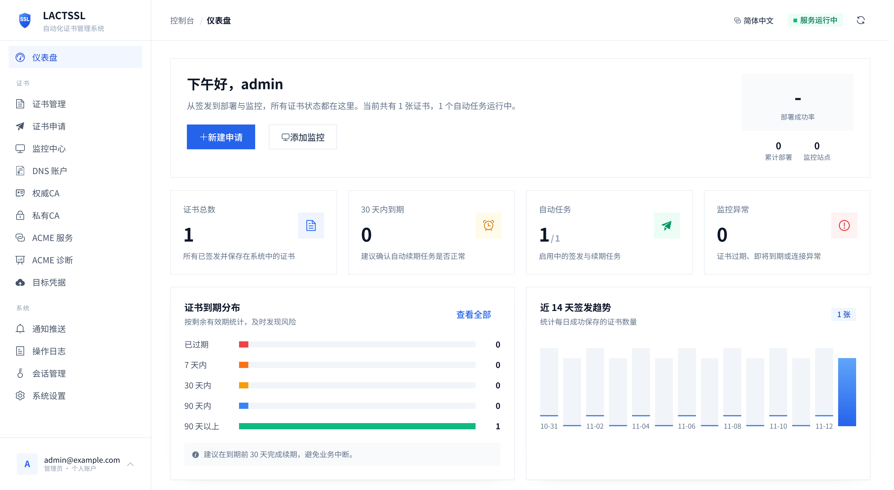

---
hide:
  - navigation
  - toc
---

<section class="hero" markdown>

Self-hosted · single instance · open source

# LACTSSL

Certificate issuance, auto-renewal, deployment, and expiry monitoring in one self-hosted console. Developers can run the full workflow on a single small host.

[Quick start](getting-started.md){ .md-button .md-button--primary }
[Install](install.md){ .md-button }
</section>

### :material-autorenew: Automatic renewal and deployment
Request, renew, deploy, and monitor ACME certificates in one place instead of scattered scripts and spreadsheets.

### :material-server-network: Private CA and internal ACME
Generate or import a root / intermediate CA and expose a standard ACME v2 endpoint for certbot, lego, and acme.sh.

### :material-file-export-outline: Multi-target delivery
Local directories and SSH/SFTP are built in; FTP, Webhook, cloud CDNs, BaoTa, 1Panel, and SafeLine WAF are added through deployment plugins.

### :material-monitor-eye: Endpoint expiry monitoring
Read external site certificates on a schedule, verify the chain and hostname, and notify on errors or expiry.

### :material-shield-check-outline: Auditable and self-hosted
Single binary, SQLite, no external dependencies; secure entry, TOTP/passkeys, field encryption, operation logs, and encrypted backups.

### :material-bell-ring-outline: Notifications and integration
Email is built in, common channels ship with the app, and the REST API with scoped API keys supports CI/CD.

## Documentation

[:material-rocket-launch-outline: Quick start](getting-started.md)
Install, initialize, and issue your first certificate.

[:material-download-outline: Install](install.md)
Docker, binary, reverse proxy, and HTTPS.

[:material-format-list-checks: Capabilities](features.md)
Certificates, tasks, private CA, ACME service, and monitoring.

[:material-server-network: Architecture](architecture.md)
Topology, ports, capacity, and availability.

[:material-shield-lock-outline: Security baseline](security.md)
Identity, encryption, auditing, and the go-live checklist.

[:material-cog-outline: Configuration](configuration.md)
Every field, reverse proxy notes, and plugin settings.

## Interface

[{ .doc-screenshot .doc-screenshot--home }](assets/images/dashboard.png){ target="_blank" rel="noreferrer" }

LACTSSL is a self-hosted tool with one administrator and one instance. It does not provide multi-user RBAC, SSO, clustering, or HSM. See [Capabilities](features.md) for the full scope.

